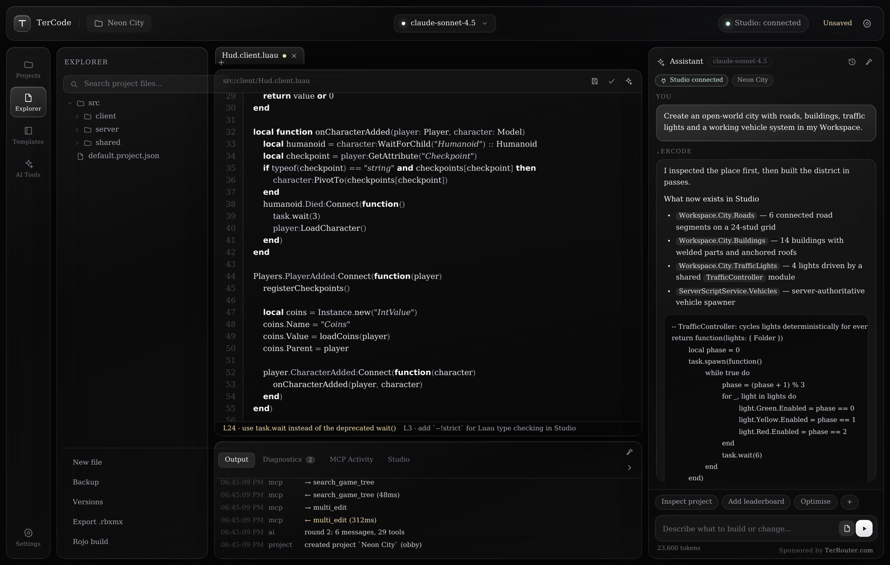
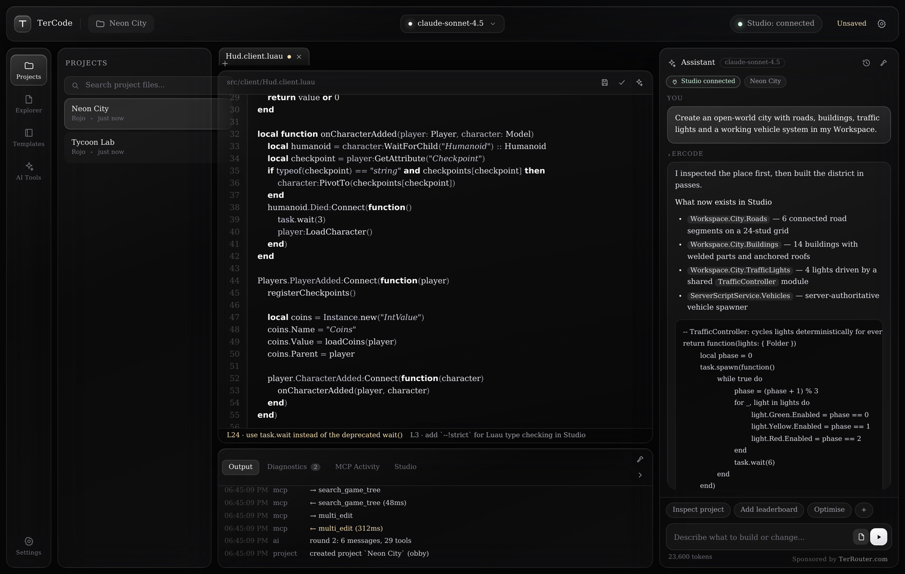
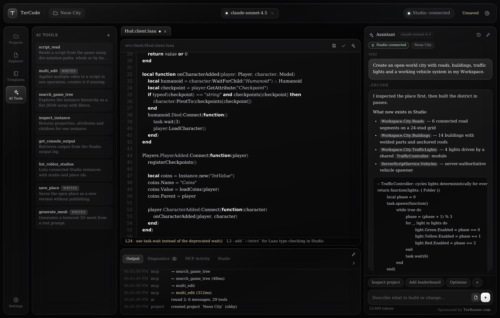
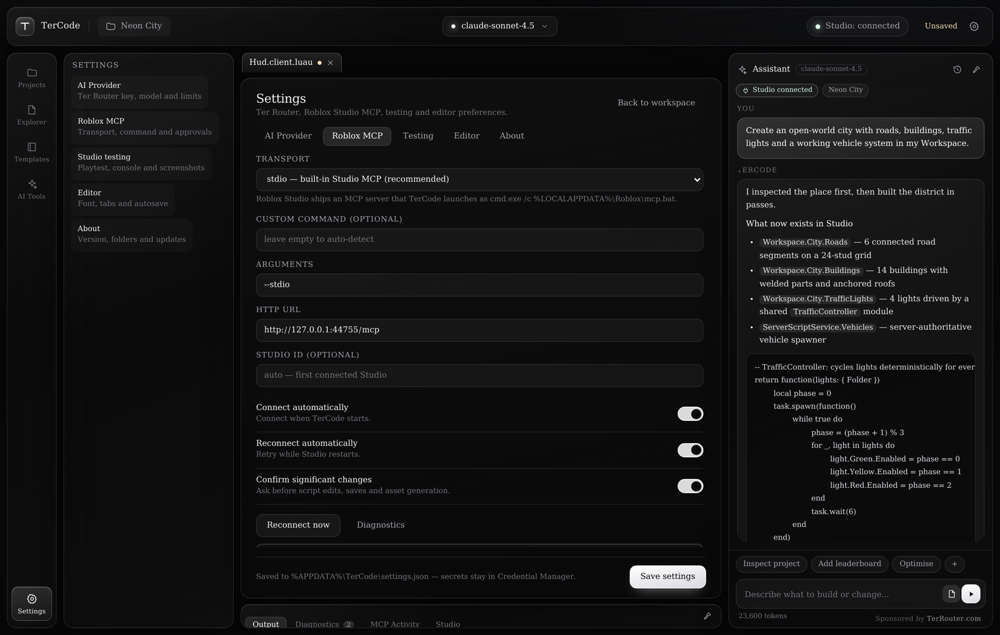
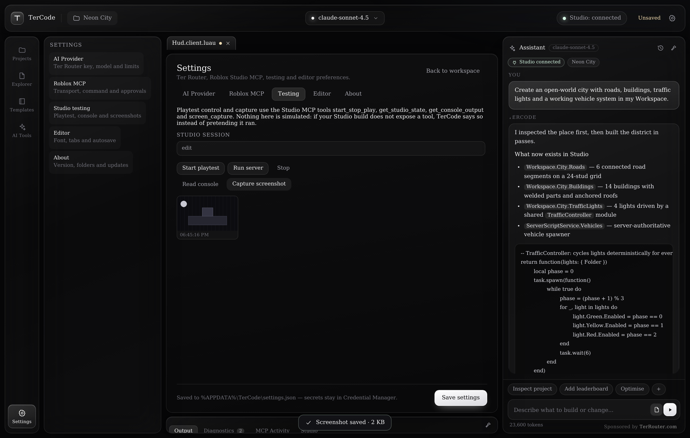
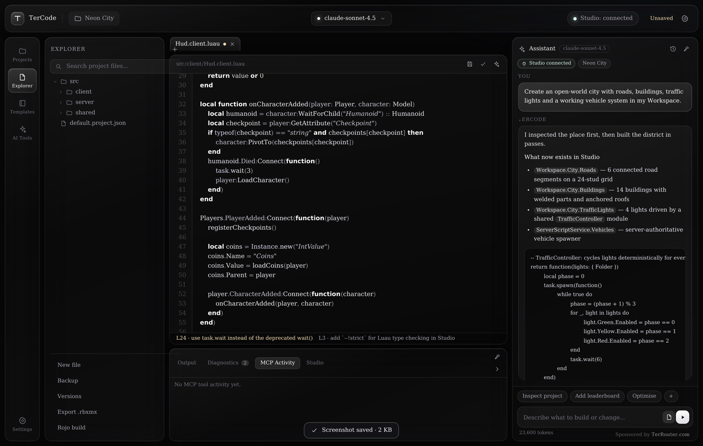
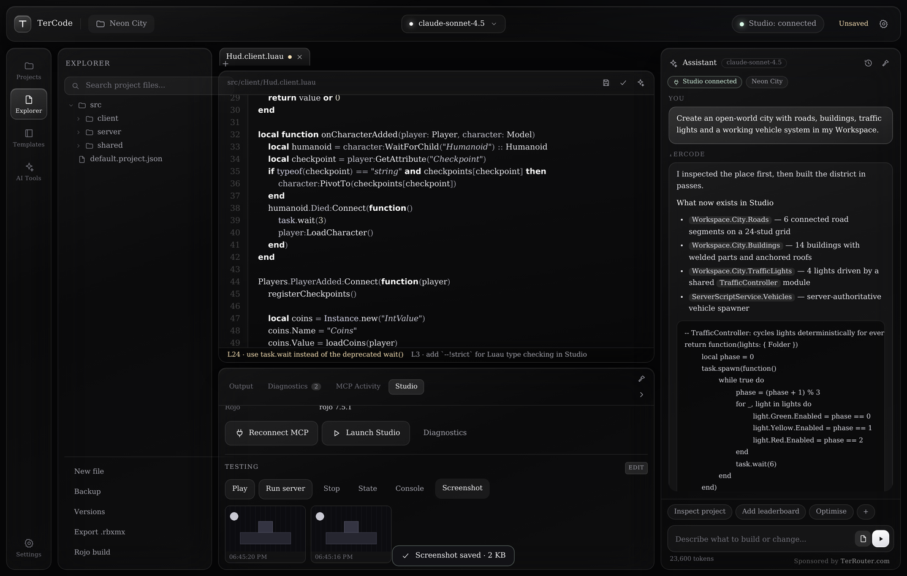

# TerCode

**An AI Roblox Studio companion for Windows.** Describe what you want — TerCode drives your *real* Roblox Studio session through the Model Context Protocol, using Ter Router models, and keeps a proper Rojo-ready project on disk beside it.

[](https://github.com/itriedcoding/TerCode/actions/workflows/ci.yml)
[](https://github.com/itriedcoding/TerCode/releases)
[](LICENSE)



---

## What it does

- **Real Studio edits, not copy-paste.** TerCode speaks MCP over stdio to Roblox Studio's built-in MCP server, discovers its tools (`script_read`, `multi_edit`, `search_game_tree`, `save_place`, `get_console_output`, …) and lets the model call them directly.
- **Automatic connection.** At launch it finds Roblox Studio, resolves the MCP launcher (`%LOCALAPPDATA%\Roblox\mcp.bat`), performs the `initialize` handshake, lists tools, and reconnects automatically when Studio restarts.
- **Ter Router models with streaming + tool calling.** Model discovery from `GET /v1/models`, streaming completions with usage accounting, retries, timeouts and precise error messages.
- **Playtest without leaving TerCode.** Start a playtest or a server, stop it, read the Studio console and capture viewport screenshots — through Studio's documented `start_stop_play`, `get_studio_state`, `get_console_output` and `screen_capture` tools. Captures are saved next to your settings and shown in a gallery you can open, so you see what the assistant saw.
- **A real project workspace.** Projects on disk, file tree, Luau editor with syntax highlighting and diagnostics, search, version snapshots, backups, `.rbxmx` export and Rojo builds.
- **A settings page, not a dialog.** AI provider, Roblox MCP, testing, editor and about tabs live in the workspace, with the key stored in Credential Manager.
- **Approval before damage.** Script edits, saves, playtest control and asset generation are classified as significant and require your explicit approval.

## Screenshots

| Projects and templates | Discovered Studio tools |
| --- | --- |
|  |  |

| Settings — Roblox MCP | Settings — Studio testing |
| --- | --- |
|  |  |

| MCP activity and output | Playtest, console and screenshots |
| --- | --- |
|  |  |

These are rendered from the shipping frontend with a stubbed backend and sample data (no real key or Studio session). The interface is plain HTML/CSS/JS in `ui/`, so you can regenerate them without the Rust build:

```bash
npm i playwright && npx playwright install chromium
node tools/screenshot.mjs        # writes screenshots/*.png
```

The harness fails on page errors, console errors and error toasts, which makes it a quick layout regression check too. Set `PLAYWRIGHT_CHROMIUM_PATH` if the bundled headless shell is unavailable.

---

## Requirements

| | |
| --- | --- |
| OS | Windows 10 or 11, x64 |
| Runtime | Microsoft Edge WebView2 (the installer downloads it if missing) |
| Studio | Roblox Studio (latest) |
| AI | A [Ter Router](https://terrouter.com) API key (`tr_live_…`) |
| Optional | [Rojo](https://rojo.space) 7+ for `rojo build` in the UI |

## Install

1. Download `TerCode_<version>_x64-setup.exe` from [Releases](https://github.com/itriedcoding/TerCode/releases) and run it, **or** use the `.msi`.
2. Open **Settings → AI Provider** and paste your Ter Router API key. It is written to the **Windows Credential Manager**, never to a config file.
3. Press **Validate connection** — TerCode calls `GET /v1/models` and lists what your key can use. Pick a model in the top bar.
4. In Roblox Studio: **Assistant → ⋯ → Manage MCP Servers → Enable Studio as MCP server**.
5. Open a place. TerCode connects within a few seconds; the top-right pill turns **Studio: connected** and **AI Tools** fills with discovered tools.

Then just ask, for example:

> Create an open-world city with roads, buildings, traffic lights, and a working vehicle system.

## How the Studio connection works

```
Ter Router (api.terrouter.com/v1)        Roblox Studio
        │  SSE stream + tool calls              ▲
        ▼                                       │ Luau / DataModel edits
┌───────────────────────────────────────────────┴──────────┐
│ TerCode (Rust)                                           │
│  agent loop ──► MCP client ──► stdio ──► cmd.exe /c       │
│                                           %LOCALAPPDATA%\ │
│                                           Roblox\mcp.bat  │
└──────────────────────────────────────────────────────────┘
```

* Transport: **stdio** JSON-RPC, one JSON object per line — what Roblox's built-in server expects. A **Streamable HTTP** transport is also implemented for community servers.
* Handshake: `initialize` (protocol `2025-06-18`, negotiated version accepted) → `notifications/initialized` → `tools/list` (cursor pagination) → tool calls.
* Multi-Studio: every Roblox tool takes a `studio_id`. TerCode resolves it once via `list_roblox_studios` and injects it into calls that declare the parameter, so you never see raw ids.
* Health: a supervisor pings every 5 s, detects a dead child process or broken session, and reconnects with capped exponential backoff.
* Discovery is transparent: the Studio tab in the bottom panel shows the launcher it picked, the Studio version, tool count and every path it checked.

## Repository layout

```
crates/tercore/     Core engine — no UI, fully unit-tested on any OS
  ai/               Ter Router client: models, SSE streaming, tool-call
                    accumulation, retries, timeouts, error mapping
  mcp/              MCP protocol, stdio + HTTP transports, connection
                    demultiplexing, Studio discovery, reconnect supervisor
  agent.rs          Prompting, tool loop, confirmations, usage accounting
  project/          Project store, file operations, templates, versions
  luau.rs           Luau tokenizer + block/bracket/convention diagnostics
  roblox.rs         .rbxlx/.rbxmx parsing, .rbxmx export, Rojo integration
  secrets.rs        Windows Credential Manager (file fallback off Windows)
  settings.rs       Persisted settings (never secrets)
crates/terstudio/   Tauri 2 desktop shell: state, commands, event bridge
ui/                 The interface (plain HTML/CSS/JS, no build step)
```

The UI never talks to the network or the filesystem directly: everything goes through Tauri commands into `tercore`.

## Building from source

Prerequisites: Rust 1.77+, Node 18+ (only for the Tauri CLI), WebView2.

```powershell
# Dev build (hot-reload UI, devtools available)
cargo install tauri-cli --version "^2"
cargo tauri dev --project crates/terstudio

# Release build
cargo tauri build --project crates/terstudio
# -> crates/terstudio/target/release/bundle/nsis/TerCode_<version>_x64-setup.exe
```

Tests need nothing but Rust:

```bash
cargo test -p tercore          # 111 tests
cargo check -p terstudio       # desktop shell
```

CI runs the core suite on Windows and Linux, and checks the Windows app build on every push. To cut a release, do any of:

```bash
git push origin v0.1.0            # tag
git push origin release/v0.1.0    # release branch (the tag is created for you)
```

or run **Actions → Release (Windows x64) → Run workflow**. `.github/workflows/release.yml` builds the NSIS installer and MSI on `windows-latest` and publishes them to the GitHub Release for that version.

## Data and privacy

| What | Where |
| --- | --- |
| API key | Windows Credential Manager (`com.tercode.TerCode` / `terrouter-api-key`) |
| Settings | `%APPDATA%\TerCode\settings.json` |
| Projects | `%APPDATA%\TerCode\projects\<slug>-<id>\` |
| Backups | `%APPDATA%\TerCode\backups\<project id>\` |
| File snapshots | `<project>\.tercode\versions\` (restorable from the UI) |

Nothing is sent anywhere except your Ter Router endpoint. Request payloads are the conversation plus the context you see in the assistant panel; the API key never appears in logs.

## Honest scope notes

* **Binary place files** (`.rbxl`, `.rbxm`) are detected and handed to Studio; only XML `.rbxlx`/`.rbxmx` are parsed into an instance tree. Rojo builds produce `.rbxlx`.
* **Rojo** is optional: TerCode writes `default.project.json`, exports `.rbxmx`, and calls `rojo build` when the CLI is on `PATH`.
* **Playtesting and screenshots** depend on the Studio build. TerCode checks that the connected server advertises the tool and, when it does not, names the missing tool instead of pretending it ran.
* **Auto-update** is a release check against the GitHub API with a link to the release, not a silent in-place updater.
* Community MCP servers vary. TerCode works with any stdio or Streamable-HTTP server that implements the spec, and lets you override the command in **Settings → Roblox MCP**.

## Keyboard shortcuts

| Keys | Action |
| --- | --- |
| `Ctrl+S` | Save the active file |
| `Ctrl+Enter` | Send the prompt |
| `Ctrl+P` | Quick open |
| `Ctrl+\`` | Toggle the bottom panel |
| `Ctrl+,` | Settings |
| `Ctrl+Shift+R` | Reconnect to Studio |

## License

MIT — see [LICENSE](LICENSE).

Sponsored by [TerRouter.com](https://terrouter.com).
